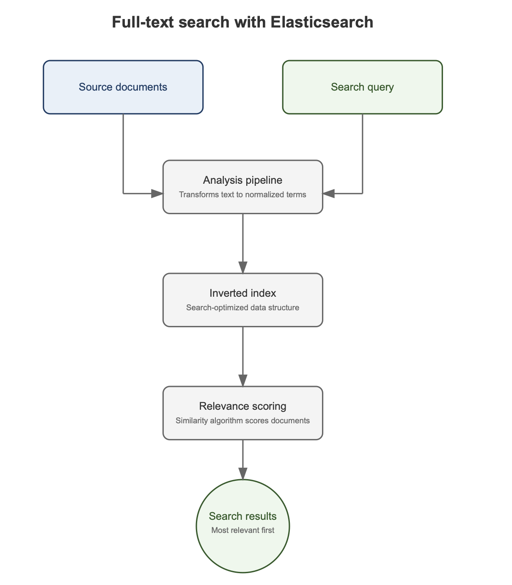

import { Card, Aside, Icon, Steps } from '@astrojs/starlight/components';

L'énoncé de laboratoire sur Elasticsearch simplifie fortement la façon dont le système stocke les données et procède pour faire une recherche sur celles-ci. Ceci pose notamment des problèmes pour la recherche dans des champs au format texte. Le présent énoncé rentre un peu plus dans les détails, et corrige la requête de recherche floue proposée dans le TD précédent.

## 1) Les index sous Elastisearch

Chaque index créé sous Elasticsearch est lié à un `mapping`, qui définit notamment les noms des champs des documents JSON qui seront stockés et les types de données qui seront utilisés pour chaque champ.

La documentation officielle d'Elasticsearch donne décrit mapping associé à un index de la façon suivante:

*Definitions that specify field data types, and control how data is indexed and queried. Understanding field data types helps you write effective queries and avoid indexing problems.*

On peut laisser ElasticSearch définir ce mapping lui-même (il infère le type de donnée en fonction des données qu'on lui envoie), c'est ce que Elastic appelle le `dynamic mapping`.

Le mapping en question est souple: on peut ajouter un nouveau champ à tout moment, et cela n'oblige pas les documents JSON de l'index à avoir exactement les champs précisés dans le mapping. Certains champs du mapping peuvent être absents dans le JSON, le JSON peut avoir des champs en plus, ...

## 2) Les types de données sous Elasticsearch

Elasticsearch propose de nombreux types de données pour les champs des documents JSON. Par exemple, pour stocker du texte, Elasticsearch met à notre disposition les types `text` et `keyword`. Constultez la documentation en ligne pour avoir un aperçu des types de données mis à votre disposition.

Par défaut, le dynamic mapping stocke les chaînes de caractère au format `text`. En quoi cela est-il important ? 

## 3) Analyse de texte sous Elasticsearch

L'idée est la suivante: avec le format `text`, il applique un analyseur à la donnée lors de l'indexation: essentiellement un algorithme qui va décomposer et formater le texte de façon à faciliter divers types de recherche (voir résultat ci-joint). Le résultat de cet algorithme est stocké dans une structure de données appelée `index inversé`.  L'analyseur standard d'Elasticsearch appliqué sur les champs `text` a notamment pour effet de transformer les caractères alphanumériques en minuscules.

 

Il est donc important, soit de bien passer par le pipeline d'analyse (illustré ci-dessus) avant de procéder à une recherche dans l'index inversé soit de penser à fournir le caractère alphanumérique à rechercher en minuscule à ElasticSearch.

La requête `match` d'ElasticSearch permet de s'assurer que ce pipeline est bien utilisé, ce qui nous permet de corriger la requête présentée au TD précédent pour la requête floue:

```java
search = esClient.search(s -> s
                .index("cours")
                .query(q -> q
                        .match(m -> m
                                .field("ue")
                                .query("DOM")
                                .fuzziness(distance)
                        )
                ),
        Cours.class
);
```

Il est également possible, lors de la création de l'index, de définir le type de données du champ comme étant `keyword` (et dans ce cas la requête fuzzy proposée au TD précédent fonctionnera). Mais dans ce cas, l'analyseur n'est pas appliqué ce qui rend certaines recherches impossibles (le stemming par exemple). Tout dépend de ce que l'on souhaite rechercher. Comme précisé par la documention:

*You can map a field containing unstructured content to either a text or keyword family field. The best field type depends on the nature of the content and how you plan to search the field.*

<Card title="Configurer le mapping" icon="pencil">
Dans votre code Java, créez un nouvel index avec trois champs avec trois types de données différents que vous définirez dans un mapping approprié (voyez la fin du TD ElasticSearch pour la façon de configurer le mapping).
</Card>


N'hésitez pas à consulter la documentation officielle d'ElasticSeach pour plus de détails sur la façon de configurer un index donné.

